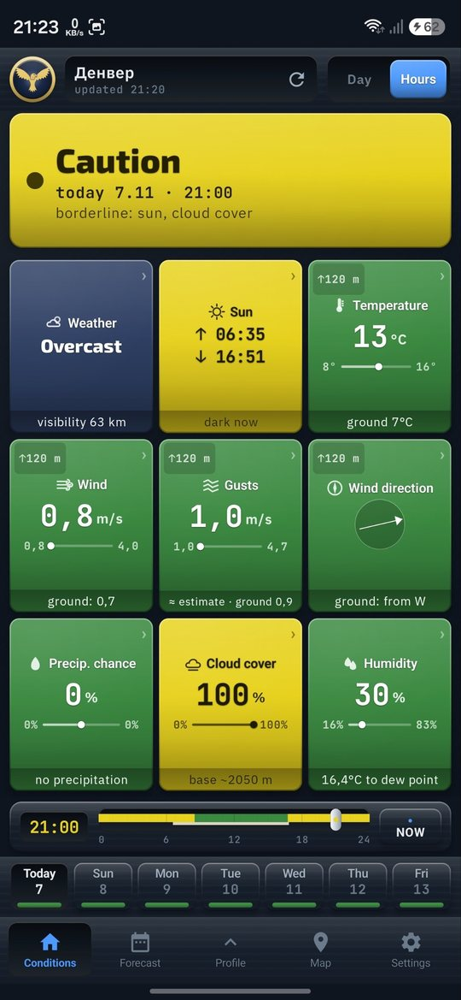
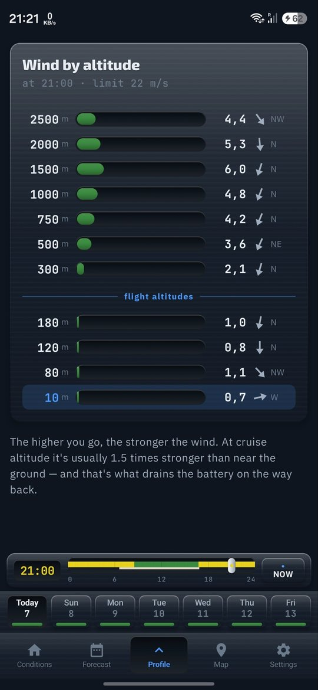
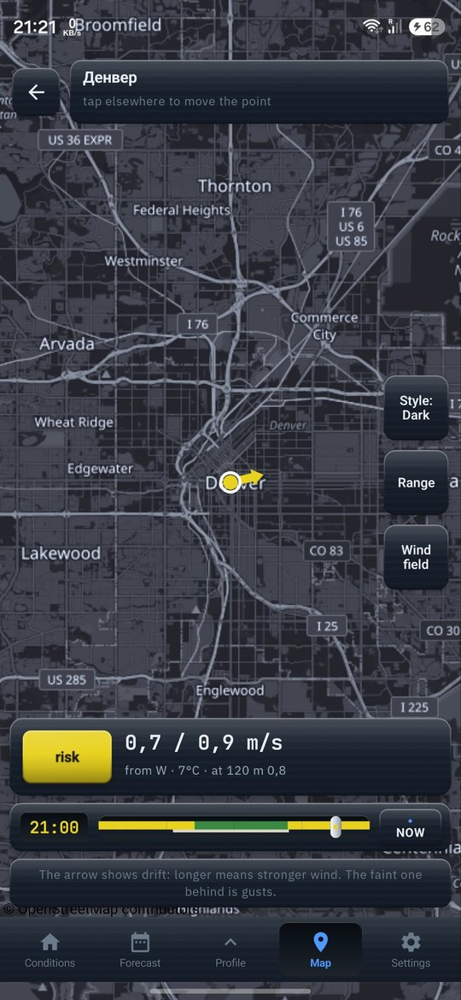
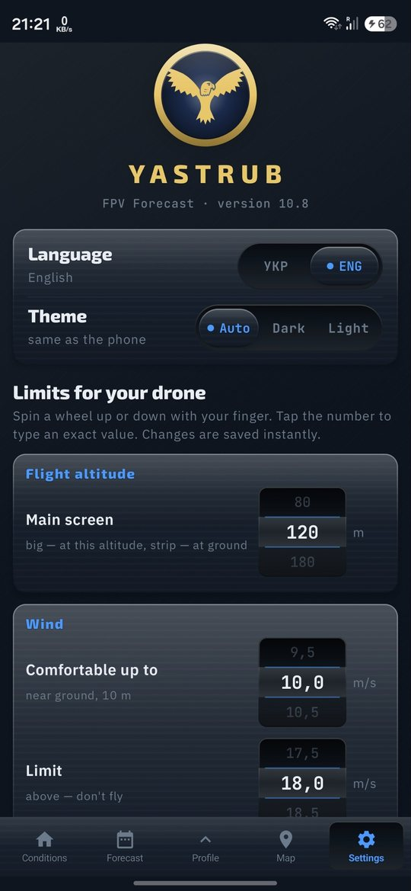

# FPV Forecast · Yastrub

**Безкоштовний прогноз погоди для FPV-пілотів.** Вітер на вашій висоті польоту, пориви, опади,
хмари, туман — і одразу видно, чи можна зараз літати.

[**⬇ Завантажити застосунок для Android (APK)**](https://github.com/MaksimCross/fpvforecast/releases/latest)

[**📱 Відкрити веб-версію (iPhone і будь-який телефон)**](https://fpvforecast.com.ua/) — на iPhone: Поділитися → *На екран «Додому»*.

  
  
  
  

## Як встановити APK

1. Відкрийте [останній реліз](https://github.com/MaksimCross/fpvforecast/releases/latest) на телефоні й завантажте файл `.apk`.
2. Відкрийте завантажений файл. Android попросить дозволити встановлення з цього джерела — дозвольте.
3. Якщо Google Play Protect попереджає про невідомий застосунок — натисніть **Усе одно встановити**.

Потрібен **Android 8.0** або новіший. Без реєстрації і без реклами.
Щоб оновитися — просто встановіть новий `.apk` поверх старого.

---

**English:** free weather forecast for FPV drone pilots — [Android APK](https://github.com/MaksimCross/fpvforecast/releases/latest) · [web version](https://fpvforecast.com.ua/).

Вихідний код закритий — див. [LICENSE](LICENSE). Сторонні компоненти: [THIRD-PARTY-NOTICES.md](THIRD-PARTY-NOTICES.md).
